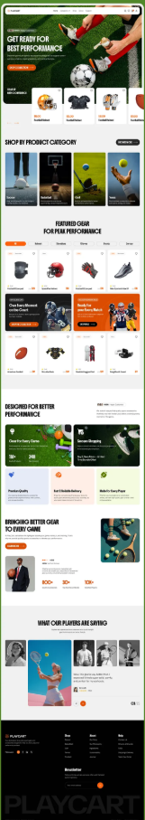

# Product Requirements Document (PRD)

## Sistem E-Commerce Penjualan Jersey Sepak Bola

| Informasi | Detail |
|---|---|
| Nama produk sementara | Jersey Store |
| Dokumen | Product Requirements Document |
| Versi | 1.0 — MVP |
| Tanggal | 13 Oktober 2026 |
| Target pasar | Pembeli jersey sepak bola di Indonesia |
| Produk utama | Jersey klub dan tim nasional |
| Model transaksi | Checkout di sistem, penyelesaian transaksi melalui WhatsApp |

---

## 1. Ringkasan Produk

Jersey Store adalah sistem e-commerce yang membantu pelanggan menemukan dan membeli jersey klub serta tim nasional. Pelanggan dapat membuat akun, memilih produk dan ukuran, memasukkan produk ke keranjang, mengisi data pemesanan, lalu melanjutkan konfirmasi transaksi melalui WhatsApp.

Sistem tetap mencatat pesanan sebelum pelanggan diarahkan ke WhatsApp. Dengan demikian, pelanggan dapat melihat riwayat pesanan dan admin dapat memantau permintaan yang masuk, mengelola produk, mengatur stok berdasarkan ukuran, serta memperbarui status pesanan.

MVP tidak menggunakan payment gateway. Pembayaran, verifikasi pembayaran, dan komunikasi lanjutan dilakukan secara manual melalui WhatsApp.

## 2. Latar Belakang Masalah

Penjualan jersey melalui media sosial atau WhatsApp saja biasanya menghadapi beberapa masalah:

- Pelanggan sulit melihat seluruh katalog secara terstruktur.
- Informasi ukuran dan ketersediaan stok sering harus ditanyakan berulang kali.
- Admin harus menyalin ulang detail pesanan dari percakapan.
- Pesanan mudah tercecer karena hanya tersimpan di chat.
- Pelanggan tidak memiliki halaman untuk melihat riwayat dan perkembangan pesanannya.
- Stok antarukuran berisiko tidak akurat.

Sistem ini memindahkan proses pencarian produk, pemilihan varian, dan pencatatan pesanan ke aplikasi, tetapi tetap mempertahankan WhatsApp sebagai kanal penyelesaian transaksi yang familier bagi pelanggan.

## 3. Tujuan Produk

### 3.1 Tujuan Utama

- Menyediakan katalog jersey klub dan tim nasional yang mudah dicari dan difilter.
- Memudahkan pelanggan memilih ukuran berdasarkan stok yang tersedia.
- Mencatat data pesanan sebelum pelanggan diarahkan ke WhatsApp.
- Menyediakan akun pelanggan dan riwayat pesanan.
- Memudahkan admin mengelola produk, ukuran, stok, dan status pesanan.
- Mengurangi kesalahan pencatatan pesanan yang sebelumnya dilakukan secara manual melalui chat.

### 3.2 Indikator Keberhasilan MVP

- Pelanggan dapat menyelesaikan alur dari katalog hingga WhatsApp tanpa bantuan admin.
- Setiap checkout menghasilkan satu nomor pesanan unik.
- Pesanan yang diarahkan ke WhatsApp muncul pada dashboard admin.
- Stok tercatat secara terpisah untuk setiap ukuran.
- Pelanggan dapat melihat kembali pesanan pada halaman riwayat.
- Admin dapat memperbarui status pesanan tanpa mengubah data langsung melalui database.

## 4. Ruang Lingkup MVP

### 4.1 Termasuk dalam MVP

- Registrasi, login, dan logout pelanggan.
- Katalog jersey klub dan tim nasional.
- Pencarian dan filter produk.
- Halaman detail produk.
- Varian ukuran dan stok per ukuran.
- Keranjang belanja.
- Checkout dan pencatatan pesanan.
- Redirect ke WhatsApp dengan pesan yang terisi otomatis.
- Riwayat dan detail pesanan pelanggan.
- Dashboard admin.
- CRUD produk, kategori, foto, ukuran, dan stok.
- Pengelolaan serta perubahan status pesanan.

### 4.2 Tidak Termasuk dalam MVP

- Payment gateway dan pembayaran otomatis.
- Perhitungan ongkir melalui API logistik.
- Jersey custom nama atau nomor punggung.
- Wishlist.
- Ulasan dan rating pelanggan.
- Kupon, voucher, atau sistem promo kompleks.
- Multi-vendor atau marketplace.
- Aplikasi mobile native.
- Integrasi otomatis dengan WhatsApp Business API.
- Retur dan refund otomatis di dalam sistem.

Fitur di luar MVP dapat dikembangkan setelah alur pembelian utama terbukti berjalan dengan baik.

## 5. Target Pengguna

### 5.1 Pelanggan

Pengguna yang ingin mencari dan membeli jersey klub atau tim nasional.

Kebutuhan utama:

- Melihat produk yang tersedia.
- Mengetahui harga, ukuran, dan stok.
- Menyimpan beberapa produk ke keranjang.
- Membuat pesanan dengan cepat.
- Mengirim detail pesanan ke WhatsApp admin.
- Melihat riwayat dan status pesanan.

### 5.2 Admin

Pengelola toko yang bertanggung jawab atas katalog, stok, dan pesanan.

Kebutuhan utama:

- Menambah dan memperbarui produk.
- Mengatur stok setiap ukuran.
- Menonaktifkan produk yang tidak dijual.
- Melihat pesanan masuk.
- Menghubungi pelanggan melalui WhatsApp.
- Memperbarui status pesanan.

## 6. Peran dan Hak Akses

### Pelanggan

- Mengakses katalog dan detail produk.
- Membuat serta mengelola akun sendiri.
- Mengelola keranjang milik sendiri.
- Membuat pesanan.
- Melihat pesanan milik sendiri.
- Membuka WhatsApp untuk mengonfirmasi pesanan.

### Admin

- Mengakses dashboard admin.
- Mengelola seluruh produk, kategori, ukuran, gambar, dan stok.
- Melihat seluruh pelanggan dan pesanan.
- Memperbarui status pesanan.
- Mengaktifkan atau menonaktifkan produk.
- Melihat ringkasan penjualan dan stok minimum.

Pengguna biasa tidak boleh mengakses halaman atau operasi khusus admin.

## 7. Alur Utama Pelanggan

1. Pelanggan membuka homepage.
2. Pelanggan menelusuri atau mencari jersey.
3. Pelanggan membuka detail produk.
4. Pelanggan memilih ukuran yang masih tersedia.
5. Pelanggan menentukan jumlah produk.
6. Pelanggan menambahkan produk ke keranjang.
7. Pelanggan membuka keranjang dan memeriksa pesanan.
8. Pelanggan login atau membuat akun jika belum terautentikasi.
9. Pelanggan mengisi nama penerima, nomor WhatsApp, dan alamat.
10. Sistem memvalidasi ulang stok dan menghitung total.
11. Sistem membuat pesanan dengan status `Menunggu Konfirmasi`.
12. Sistem mengurangi atau menahan stok sesuai kebijakan stok MVP.
13. Sistem membuka WhatsApp admin dengan pesan pesanan yang sudah terisi.
14. Pelanggan dan admin menyelesaikan pembayaran serta pengiriman melalui WhatsApp.
15. Admin memperbarui status pesanan melalui dashboard.
16. Pelanggan melihat perubahan status pada riwayat pesanan.

## 8. Alur Checkout WhatsApp

### 8.1 Prinsip Utama

Pesanan harus disimpan ke database sebelum redirect ke WhatsApp. Redirect saja tanpa menyimpan pesanan akan membuat riwayat pelanggan dan dashboard admin tidak akurat.

### 8.2 Format Pesan WhatsApp

```text
Halo Admin Jersey Store, saya ingin mengonfirmasi pesanan berikut:

Nomor Pesanan: ORD-20261013-0012
Nama: Muhammad Aidil Akbar
No. WhatsApp: 08xxxxxxxxxx

Pesanan:
1. Jersey Tim Nasional Indonesia 2026
   Ukuran: L
   Jumlah: 1
   Harga: Rp450.000

Subtotal: Rp450.000
Ongkir: Akan dikonfirmasi admin
Total Sementara: Rp450.000

Alamat:
[alamat pelanggan]

Mohon konfirmasi ketersediaan, ongkir, dan metode pembayarannya. Terima kasih.
```

### 8.3 URL Redirect

Sistem menggunakan format berikut:

```text
https://wa.me/{nomor_admin}?text={pesan_yang_sudah_di-encode}
```

Nomor WhatsApp admin harus dapat diubah melalui konfigurasi tanpa mengubah source code.

## 9. Status Pesanan

| Status | Penjelasan |
|---|---|
| `Menunggu Konfirmasi` | Pesanan sudah dibuat dan pelanggan diarahkan ke WhatsApp. |
| `Dikonfirmasi` | Admin telah mengonfirmasi produk, ukuran, dan biaya akhir. |
| `Menunggu Pembayaran` | Pelanggan diminta melakukan pembayaran. |
| `Dibayar` | Pembayaran telah diverifikasi admin. |
| `Diproses` | Pesanan sedang disiapkan. |
| `Dikirim` | Pesanan telah diserahkan kepada kurir. |
| `Selesai` | Pesanan telah diterima atau dinyatakan selesai. |
| `Dibatalkan` | Pesanan dibatalkan oleh pelanggan atau admin. |

Perubahan status harus tercatat dengan waktu perubahan. Untuk MVP, riwayat status dapat disimpan agar admin dan pelanggan dapat melihat progres pesanan.

## 10. Kebutuhan Fungsional

### 10.1 Autentikasi Pelanggan

- Pengguna dapat mendaftar menggunakan nama, email, nomor WhatsApp, dan password.
- Email harus unik.
- Pengguna dapat login dan logout.
- Pengguna dapat meminta reset password.
- Pengguna dapat memperbarui data profil.
- Password tidak boleh disimpan dalam bentuk teks biasa.

### 10.2 Katalog Produk

- Pengguna dapat melihat daftar produk aktif.
- Produk dapat dikelompokkan menjadi `Klub` dan `Tim Nasional`.
- Produk dapat memiliki informasi tim, kompetisi atau konfederasi, musim, tipe jersey, harga, deskripsi, dan beberapa gambar.
- Pengguna dapat mencari berdasarkan nama produk atau nama tim.
- Pengguna dapat memfilter berdasarkan kategori, ukuran tersedia, rentang harga, dan tipe jersey.
- Pengguna dapat mengurutkan berdasarkan terbaru, harga terendah, dan harga tertinggi.
- Produk yang tidak aktif tidak ditampilkan kepada pelanggan.

### 10.3 Detail Produk

- Menampilkan nama, harga, kategori, tim, musim, deskripsi, dan galeri gambar.
- Menampilkan pilihan ukuran beserta ketersediaannya.
- Ukuran tanpa stok harus tampil sebagai tidak tersedia dan tidak dapat dipilih.
- Pengguna harus memilih ukuran sebelum menambahkan produk ke keranjang.
- Jumlah pembelian tidak boleh melebihi stok varian.

### 10.4 Keranjang Belanja

- Pengguna dapat menambahkan produk dan ukuran ke keranjang.
- Produk yang sama dengan ukuran berbeda dianggap sebagai item berbeda.
- Pengguna dapat mengubah jumlah atau menghapus item.
- Sistem menghitung subtotal secara otomatis.
- Sistem memvalidasi ulang harga dan stok sebelum checkout.
- Keranjang pelanggan yang login dapat disimpan agar tetap tersedia setelah pengguna kembali.

### 10.5 Checkout

- Checkout hanya dapat dilakukan oleh pengguna yang sudah login.
- Pelanggan mengisi atau memilih data penerima.
- Field wajib: nama penerima, nomor WhatsApp, alamat lengkap, kota/kabupaten, provinsi, dan kode pos.
- Catatan pesanan bersifat opsional.
- Sistem menampilkan ringkasan item dan subtotal.
- Ongkir ditampilkan sebagai `Dikonfirmasi melalui WhatsApp` pada MVP.
- Setelah pelanggan menyetujui ringkasan, sistem membuat pesanan dan nomor pesanan unik.
- Sistem mengosongkan keranjang setelah pesanan berhasil dibuat.
- Sistem mengarahkan pelanggan ke WhatsApp admin.

### 10.6 Akun dan Riwayat Pesanan

- Pelanggan dapat melihat informasi profil.
- Pelanggan dapat melihat daftar pesanan dari yang terbaru.
- Daftar menampilkan nomor pesanan, tanggal, jumlah item, total sementara, dan status.
- Pelanggan dapat membuka detail pesanan.
- Pelanggan hanya dapat melihat pesanan miliknya sendiri.
- Pelanggan dapat menekan tombol `Hubungi Admin` dari detail pesanan.

### 10.7 Manajemen Produk oleh Admin

- Admin dapat membuat, membaca, memperbarui, dan menonaktifkan produk.
- Admin dapat mengatur kategori `Klub` atau `Tim Nasional`.
- Admin dapat mengunggah beberapa gambar produk.
- Admin dapat menentukan gambar utama.
- Admin dapat mengelola harga dan deskripsi.
- Admin dapat mengatur ukuran seperti S, M, L, XL, dan XXL.
- Setiap ukuran memiliki stok tersendiri.
- Admin dapat melihat produk dengan stok rendah atau habis.
- Penghapusan produk sebaiknya menggunakan soft delete atau status nonaktif agar data pesanan lama tetap valid.

### 10.8 Manajemen Pesanan oleh Admin

- Admin dapat melihat seluruh pesanan.
- Admin dapat mencari berdasarkan nomor pesanan, nama pelanggan, atau nomor WhatsApp.
- Admin dapat memfilter berdasarkan status dan rentang tanggal.
- Admin dapat membuka detail pesanan.
- Admin dapat memperbarui status pesanan.
- Admin dapat menambahkan catatan internal.
- Admin dapat membuka WhatsApp pelanggan dari halaman pesanan.
- Admin tidak dapat mengubah snapshot nama produk, ukuran, harga, dan jumlah pada pesanan yang sudah dibuat tanpa pencatatan perubahan.

### 10.9 Dashboard Admin

Dashboard minimal menampilkan:

- Jumlah pesanan baru.
- Jumlah pesanan menunggu pembayaran.
- Jumlah pesanan yang sedang diproses.
- Jumlah produk aktif.
- Daftar stok rendah.
- Pesanan terbaru.

Nilai omzet pada MVP hanya dihitung dari pesanan berstatus `Dibayar`, `Diproses`, `Dikirim`, atau `Selesai`.

## 11. Aturan Bisnis

### 11.1 Produk dan Varian

- Satu produk harus memiliki minimal satu ukuran aktif.
- Harga produk tidak boleh bernilai negatif.
- Stok varian tidak boleh kurang dari nol.
- Produk hanya dapat dibeli jika aktif dan varian yang dipilih memiliki stok.
- Perubahan harga produk tidak boleh mengubah harga pada pesanan lama.

### 11.2 Pesanan

- Nomor pesanan harus unik dan mudah dibaca.
- Pesanan menyimpan snapshot data produk saat checkout.
- Total item dihitung dari `harga saat checkout × jumlah`.
- Satu pesanan dapat memiliki beberapa produk dan ukuran.
- Pesanan baru selalu dimulai dengan status `Menunggu Konfirmasi`.
- Pesanan hanya boleh diakses oleh pemiliknya atau admin.

### 11.3 Kebijakan Stok MVP

Rekomendasi awal: stok langsung dikurangi ketika pesanan dibuat agar tidak terjadi overselling. Jika pesanan dibatalkan, stok dikembalikan secara otomatis.

Untuk mencegah stok tertahan terlalu lama, pesanan `Menunggu Konfirmasi` dapat memiliki batas waktu, misalnya 24 jam. Otomatisasi pembatalan dapat dimasukkan pada iterasi berikutnya jika belum diperlukan pada MVP pertama.

## 12. Struktur Halaman

### Halaman Pelanggan

| Halaman | Fungsi utama |
|---|---|
| Homepage | Menampilkan hero, kategori, produk pilihan, dan CTA. |
| Katalog | Menampilkan pencarian, filter, pengurutan, dan daftar produk. |
| Detail Produk | Menampilkan informasi produk, ukuran, stok, dan tombol tambah ke keranjang. |
| Keranjang | Mengelola item dan subtotal. |
| Checkout | Mengumpulkan alamat dan membuat pesanan. |
| Login | Autentikasi pelanggan. |
| Registrasi | Membuat akun pelanggan. |
| Profil | Mengelola data pelanggan. |
| Riwayat Pesanan | Menampilkan seluruh pesanan pelanggan. |
| Detail Pesanan | Menampilkan item, alamat, status, dan tombol WhatsApp. |

### Halaman Admin

| Halaman | Fungsi utama |
|---|---|
| Dashboard | Ringkasan pesanan, produk, dan stok. |
| Produk | Daftar, pencarian, tambah, edit, dan nonaktifkan produk. |
| Form Produk | Mengelola informasi, gambar, ukuran, harga, dan stok. |
| Pesanan | Daftar dan filter seluruh pesanan. |
| Detail Pesanan | Melihat detail, mengubah status, dan menghubungi pelanggan. |
| Pelanggan | Melihat informasi dasar pelanggan dan riwayat pesanannya. |

## 13. Model Data Awal

### `users`

- `id`
- `name`
- `email`
- `phone`
- `password_hash` atau identitas dari authentication provider
- `role` — `customer` atau `admin`
- `created_at`
- `updated_at`

### `categories`

- `id`
- `name` — Klub atau Tim Nasional
- `slug`
- `is_active`

### `products`

- `id`
- `category_id`
- `name`
- `slug`
- `team_name`
- `season`
- `jersey_type` — home, away, third, atau goalkeeper
- `description`
- `price`
- `is_active`
- `created_at`
- `updated_at`
- `deleted_at` — opsional untuk soft delete

### `product_images`

- `id`
- `product_id`
- `image_url`
- `alt_text`
- `is_primary`
- `sort_order`

### `product_variants`

- `id`
- `product_id`
- `size`
- `sku`
- `stock`
- `is_active`

Kombinasi `product_id` dan `size` harus unik.

### `carts`

- `id`
- `user_id`
- `created_at`
- `updated_at`

### `cart_items`

- `id`
- `cart_id`
- `product_variant_id`
- `quantity`

Kombinasi `cart_id` dan `product_variant_id` harus unik.

### `orders`

- `id`
- `order_number`
- `user_id`
- `customer_name`
- `customer_phone`
- `shipping_address`
- `city`
- `province`
- `postal_code`
- `customer_note`
- `admin_note`
- `subtotal`
- `shipping_cost` — nullable pada MVP
- `grand_total`
- `status`
- `whatsapp_opened_at`
- `created_at`
- `updated_at`

### `order_items`

- `id`
- `order_id`
- `product_id`
- `product_variant_id`
- `product_name_snapshot`
- `size_snapshot`
- `price_snapshot`
- `quantity`
- `line_total`

### `order_status_histories`

- `id`
- `order_id`
- `previous_status`
- `new_status`
- `changed_by`
- `note`
- `created_at`

## 14. Kebutuhan Nonfungsional

### Keamanan

- Seluruh halaman admin wajib dilindungi role-based access control.
- Pelanggan hanya dapat membaca dan mengubah data miliknya sendiri.
- Validasi harga dan stok harus dilakukan di server, bukan hanya pada UI.
- Password dikelola oleh layanan autentikasi atau disimpan dengan hashing yang aman.
- File gambar dibatasi berdasarkan tipe dan ukuran.
- Operasi stok dan pembuatan pesanan harus menggunakan transaksi database untuk mencegah inkonsistensi.

### Performa

- Halaman katalog awal ditargetkan tampil dalam waktu maksimal 3 detik pada koneksi seluler normal.
- Gambar menggunakan kompresi dan lazy loading.
- Produk menggunakan pagination atau infinite scroll.
- Pencarian dan filter tidak boleh memuat seluruh data sekaligus ke browser.

### Responsivitas

- Mendukung desktop, tablet, dan mobile.
- Alur katalog hingga WhatsApp harus nyaman digunakan pada layar ponsel.
- Target minimum lebar layar adalah 360 px.

### Aksesibilitas

- Seluruh gambar produk memiliki teks alternatif.
- Form memiliki label dan pesan error yang jelas.
- Navigasi utama dapat digunakan dengan keyboard.
- Warna teks dan tombol memiliki kontras yang memadai.

## 15. Rekomendasi Arsitektur Teknis

Rekomendasi yang ringan untuk MVP:

- Frontend: React + Vite atau Next.js.
- Styling: Tailwind CSS atau CSS Modules.
- Backend dan database: Supabase PostgreSQL.
- Authentication: Supabase Auth.
- Penyimpanan gambar: Supabase Storage.
- Authorization: Row Level Security dan pengecekan role admin.
- Hosting frontend: Vercel.
- Kanal transaksi: tautan `wa.me` dengan pesan otomatis.

Rekomendasi ini bukan batasan mutlak. PRD tetap dapat diterapkan menggunakan Laravel, Express, atau stack lain.

## 16. Kriteria Penerimaan MVP

### Katalog dan Produk

- Produk aktif tampil di katalog.
- Produk nonaktif tidak tampil kepada pelanggan.
- Filter kategori dan ukuran menghasilkan data yang benar.
- Ukuran dengan stok nol tidak dapat dipilih.

### Keranjang

- Produk dan ukuran yang dipilih dapat ditambahkan ke keranjang.
- Perubahan jumlah langsung memperbarui subtotal.
- Jumlah tidak dapat melebihi stok.
- Item dapat dihapus.

### Checkout WhatsApp

- Pengguna wajib login sebelum checkout.
- Pesanan tersimpan sebelum WhatsApp dibuka.
- Nomor pesanan unik berhasil dibuat.
- Isi pesan WhatsApp sesuai dengan data pesanan.
- Pesanan baru muncul pada dashboard admin.
- Pesanan muncul pada riwayat pelanggan.

### Admin

- Admin dapat membuat dan mengubah produk.
- Admin dapat mengatur stok per ukuran.
- Admin dapat melihat dan mencari pesanan.
- Admin dapat mengubah status pesanan.
- Pengguna biasa tidak dapat mengakses halaman admin.

### Riwayat Pesanan

- Pelanggan hanya melihat pesanannya sendiri.
- Detail pesanan mempertahankan nama dan harga saat checkout.
- Status terbaru tampil dengan benar.

## 17. Prioritas Pengembangan

### Fase 1 — Fondasi

- Setup project dan database.
- Authentication.
- Role pelanggan dan admin.
- Model kategori, produk, varian, dan gambar.

### Fase 2 — Katalog

- Homepage sederhana.
- Katalog, pencarian, filter, dan detail produk.
- Pemilihan ukuran berdasarkan stok.

### Fase 3 — Transaksi

- Keranjang.
- Checkout.
- Pembuatan nomor pesanan.
- Redirect WhatsApp.
- Riwayat dan detail pesanan pelanggan.

### Fase 4 — Admin

- Dashboard.
- CRUD produk dan varian.
- Manajemen stok.
- Daftar, detail, filter, dan status pesanan.

### Fase 5 — Pengujian dan Peluncuran

- Pengujian hak akses.
- Pengujian stok dan transaksi database.
- Pengujian alur checkout pada perangkat mobile.
- Optimasi gambar dan performa.
- Deployment produksi.

## 18. Risiko dan Mitigasi

| Risiko | Mitigasi |
|---|---|
| Pelanggan membuat pesanan tetapi tidak melanjutkan WhatsApp | Catat waktu pembukaan WhatsApp dan sediakan status kedaluwarsa atau pembatalan. |
| Stok tertahan oleh pesanan yang tidak dibayar | Tetapkan batas konfirmasi dan kembalikan stok saat dibatalkan. |
| Admin lupa memperbarui status | Tampilkan pesanan yang lama tidak berubah pada dashboard. |
| Harga atau stok berubah saat checkout | Validasi ulang seluruh item di server sebelum pesanan dibuat. |
| Pesan WhatsApp terlalu panjang | Gunakan format ringkas dan batasi jumlah item yang tidak realistis. |
| Riwayat pesanan berubah setelah produk diedit | Simpan snapshot produk, ukuran, dan harga pada `order_items`. |

## 19. Keputusan yang Masih Perlu Dikonfirmasi

- Nama dan identitas merek final.
- Nomor WhatsApp admin tujuan.
- Daftar ukuran yang digunakan toko.
- Apakah stok langsung dikurangi atau hanya ditahan ketika pesanan dibuat.
- Batas waktu pesanan yang belum dikonfirmasi.
- Metode pembayaran manual yang diterima.
- Cara penentuan ongkir pada fase awal.
- Teknologi final yang akan digunakan.

## 20. Pengembangan Setelah MVP

- Payment gateway.
- Integrasi ongkir otomatis.
- Custom nama dan nomor punggung.
- Promo dan voucher.
- Wishlist.
- Ulasan pelanggan.
- Notifikasi WhatsApp otomatis.
- Laporan penjualan dan produk terlaris.
- Pengingat stok rendah.
- Retur dan refund terstruktur.
- Progressive Web App.

---

Dokumen ini menjadi sumber acuan awal untuk perancangan UI/UX, database, API, pembagian backlog, dan pengujian sistem. Perubahan besar terhadap alur checkout, kebijakan stok, atau peran pengguna perlu diperbarui di PRD sebelum diimplementasikan.
